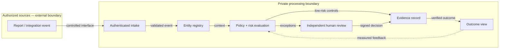

# DART Station Super Intelligence — Engineering, GRC and Evidence Walkthrough

**Status:** Public-safe engineering explanation only. This is a proposed architecture and acceptance contract, not proof of customer deployment, SOC 2 certification, live integrations or operational reliability.

## 1. The problem, explained simply

**Scenario:** A reported elevator outage at Akard Station.

**Trigger:** A station issue report or approved inspection observation.

A trustworthy system does more than produce a dashboard alert. It establishes who reported the issue, what evidence was inspected, which rules applied, which human made an important decision, what changed, and whether the outcome was independently verified.

## 2. Components and why they exist

| Component | Responsibility | Evidence it must produce |
|---|---|---|
| Intake connector | Receive authorized structured requests and reject malformed inputs | Correlation ID, source, time, schema version |
| Registry and semantic layer | Resolve canonical entities and relationships | Canonical entity IDs, data provenance |
| Rules and risk engine | Evaluate explicit controls, exceptions and policy thresholds | Rule version, reason codes and evaluation result |
| Human review | Separate requestor/operator from independent approver | Verified reviewer identity, approval or rejection |
| Evidence ledger | Record auditable lifecycle without treating a log as infallible | Source hashes, event timestamps, retention policy |
| Outcome reporting | Present verified outcomes, not unreviewed claims | Accepted/rejected status, accountable owner and checkpoint |

## 3. Horizontal architecture and trust boundaries

The drawing is a conceptual relationship map; no interface is represented as operational until separately verified. Do not publish secret architecture, sensitive endpoint addresses, PII, physical security details or banking credentials.

## 4. End-to-end example

1. **Receive:** A station issue report or approved inspection observation. Validate source, schema and authorization.
2. **Resolve identity:** Associate the event with authoritative entities. Reject ambiguous identity rather than silently guessing.
3. **Apply rules:** Detect exceptions and material changes with documented, versioned logic.
4. **Escalate:** Independent inspector accepts or rejects remediation; the crew cannot self-approve.
5. **Record:** Station ID, asset ID, inspection timestamps, assignment, permitted before/after evidence. Use approved privacy, retention and access restrictions.
6. **Deliver:** Station Readiness scorecard, evidence trace, work-order state. Label simulated records as synthetic.

## 5. Actual repository technology

Next.js, React, TypeScript, Tailwind, Vitest and Playwright in the existing public demonstration.

Do not copy the reference repository's Google Cloud Functions, SCC, Vertex AI, SendGrid or Terraform stack merely to reproduce its documentation. Those are reference-specific technologies, not product requirements here.

## 6. Step-by-step engineering reproduction

1. Clone this repository and read its existing README, design standards and agent instructions before changing code.
2. Install only dependencies declared by the checked-in lockfile or requirements.
3. Run the existing baseline tests and record commit hash, command, results and failures.
4. Create a deterministic synthetic station event fixture.
5. Implement the smallest behavior that yields a controlled decision and complete evidence trace.
6. Run unit, integration, negative authorization and user-journey tests.
7. Compare before/after tests, latency, human intervention and false approval/denial metrics; record actual values, not estimates.
8. Open a reviewable PR with a short explanation, screenshots where relevant, and reproducible logs.
9. Publish only approved sanitized demonstration artifacts. A merged PR does not automatically authorize customer deployment.

**Baseline commands or checks:** npm run lint && npm run typecheck && npm run test:unit; GITHUB_PAGES=true npm run build; npm run test:e2e.

## 7. Example acceptance tests

| ID | Scenario | Expected |
|---|---|---|
| E01 | Authorized valid event | Traceable event ID; no dropped context |
| E02 | Missing/invalid identity | Deny or hold; reason recorded |
| E03 | High-risk exceptional event | Human review required before consequential release |
| E04 | Operator attempts self-approval | Rejected by role separation |
| E05 | Evidence absent or tampered | Verification fails; cannot become accepted |
| E06 | Reviewer rejects proposed outcome | State remains held/open, auditable reason |
| E07 | Replay or duplicate submission | Idempotent processing or explicit duplicate flag |
| E08 | Report generated | Report backed by source events and approval state |
| E09 | Accessibility and device parity | Applicable UI tests demonstrate consistency |
| E10 | Public release review | Synthetic only; privacy and secrets review passed |

These are **test specifications**, not claims of passed tests.

## 8. Governance and control-to-evidence mapping

| Control objective | Implementation requirement | Independent verification |
|---|---|---|
| Least privilege | Role-scoped permissions with deny-by-default | Unauthorized action test |
| Separation of duties | Different actor for execution and final verification | Self-approval denial test |
| Traceability | Correlation IDs, event chain and timestamps | Replay and evidence audit |
| Integrity | Hash and version evidence, restrict edits | Tamper detection test |
| Privacy | Data minimization, redaction, retention and deletion | Privacy review and retention test |
| Change management | Reviewed PRs, CI and rollback | Commit + review + pipeline log |
| Continuous improvement | Baseline, candidate and repeated benchmark | Reproducible comparison report |

No specific compliance certification is asserted by this mapping.

## 9. Known limitations and next enhancements

All publicly shown operational records are synthetic; no live DART integration or customer approval is claimed.

Next: verified source connectors, secure environment isolation, production-grade audit semantics, measured scenario evaluations, role-based controls, independent evidence review, and periodic improvement-loop reports.

## 10. Attribution

The education-first format (introduction, analogy, stack explanation, worked execution, test examples, code structure, evidence and improvements) was informed by [GCP Automated Access Review — GRC Engineering](https://github.com/TrevinoParker7/GCP_Automated_Access_Review_GRC_Engineering). This content is independently adapted for DART Station Super Intelligence; its code stack and claims are not imported.
