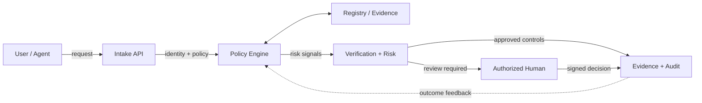

# DART Station Super Intelligence — Public System Guide

> Public architectural explanation and synthetic demonstration. This is not a claim of production integration, independent audit, compliance certification or customer endorsement.

## 1. What problem does this solve?
Station teams need to track cleanliness, safety, accessibility and maintenance issues from report through independently verified remediation.

## 2. Real-world analogy
Think of a station inspection as an aircraft maintenance log: identifying a problem is not enough; a distinct authorized reviewer must verify the fix.

## 3. System components
| Component | Purpose | Current public claim |
|---|---|---|
| User experience | Explain status, decisions and evidence | Demonstration; verify individual feature status |
| Intake | Receive reports or requests | Illustrative interface |
| Policy and identity | Determine authorized roles and rules | Design target, not certified security control |
| Verification engine | Evaluate evidence and exceptions | Proposed architecture |
| Evidence and audit | Record traceable decisions | No claim of deployed immutable ledger |
| Human review | Resolve high-impact exceptions | Required production control |

## 4. End-to-end journey
Report issue → classify station and asset → assign authorized contractor → upload completion evidence → independent inspection → update station readiness scorecard.

## 5. Horizontal system concept map

This is a **conceptual** map: not an assertion of deployed API endpoints or live data flows. Trust boundaries and production interfaces are documented internally.

## 6. Implementation and technology
Use the actual repository source and its README for implementation details and verified commands. This guide does not claim a copied Express, GraphQL, or AI agent implementation. Unlike the reference tutorial, architectural patterns are adapted rather than copying its stack.

## 7. Security principles
Least privilege, short-lived scoped access where appropriate, role separation, deny-by-default, explicit human authorization for consequential decisions, privacy and evidence retention. Never commit live credentials, real customer footage or invoice financial records into public Git.

## 8. Tests and verification
Validate role boundaries, invalid requests, evidence integrity, rejected/fraud scenarios, accessibility, mobile behavior and deterministic replay. A tested local demo must not be presented as production integration.

## 9. What is live versus proposed?
Only mark a capability live if an executable test, deployment or authoritative integration record demonstrates it. Synthetic examples must be labeled. Roadmaps and payment terms are proposals until approved.

## 10. Further improvements
Build measured end-to-end reliability, independent evidence review, security threat modeling, data lineage, scenario benchmarks and continuously evaluated agent harnesses. Publish only reviewed, sanitized findings.

### Reference and attribution
Documentation structure is adapted from the educational approach in [AI Identity Governance Agentic AI](https://github.com/TrevinoParker7/AI_Identity): plain-language introduction, analogy, component explanations, walkthrough, concept maps and future improvements. Original content, domain, implementation and security claims are specific to DART Station Super Intelligence.
